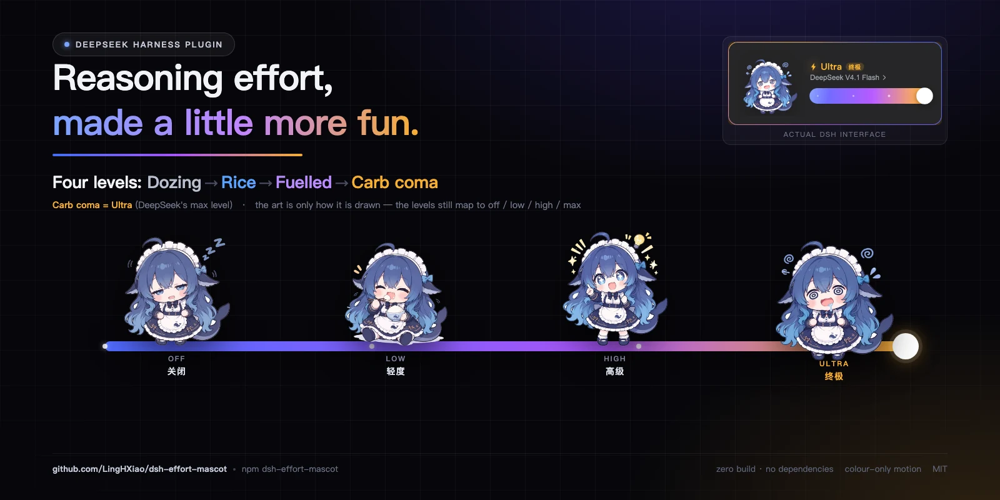
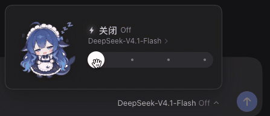
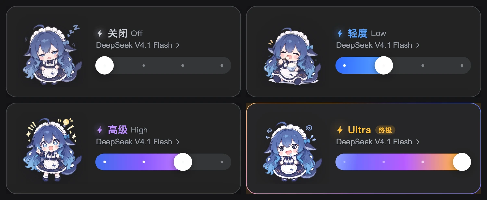

# dsh-effort-mascot

**English** | [中文](README.md)

[](https://www.npmjs.com/package/dsh-effort-mascot)
[](https://www.npmjs.com/package/dsh-effort-mascot)
[](https://github.com/LingHXiao/dsh-effort-mascot/actions/workflows/seat-drift.yml)




DSH ships reasoning effort as a dropdown where all four options look identical. This replaces it with a card, and the card has a fish on it.

The fish is the effort level: dozing because it hasn't eaten (Off), shovelling rice (Low), fuelled up and beaming (High), and — having overdone it — carb-comatose (Ultra). The card's palette follows along: grey → blue → purple → a gold ring.

To be clear, **the artwork is only how it is drawn**. The four levels still map one-to-one onto `reasoningEffort` — off / low / high / max. Pick a level and the model thinks at that level; nothing about that changed. Only the way it looks did.

> **One mapping worth stating**: the **Ultra** label is DeepSeek's `max` level. It only gets a friendlier name and a visual identity; the request still carries `reasoningEffort: "max"`. The other three keep the adapter's own names (Off / Low / High).

Nothing underneath changed: it reuses the official model directory and `session.selectModel` — the same control, drawn differently.

> **The card is always dark and deliberately does not follow the light/dark theme.** It reads as a dark material floating above the composer, which keeps the illustrations and the gold highlights working in both themes.


Dragging through the levels, landing on Ultra (which opens with a one-off notice):



> The GIF is capped at 15fps so it can autoplay inline. Full speed and audio: [download the video](https://raw.githubusercontent.com/LingHXiao/dsh-effort-mascot/main/docs/slider-demo.mp4).

**Three things worth knowing**

- **Four levels, four faces** — it is not just a colour swap: the mascot itself changes (dozing → snacking → eureka → overload)
- **Colour-only motion** — rotating ring, brightness breathing, slider sheen, bolt glow; nothing moves position, nothing is dizzying
- **Quiet by default** — honours `prefers-reduced-motion`; with it on, everything freezes and the Ultra notice is skipped

## Install

```sh
dsh plugin add dsh-effort-mascot
```

Restart `dsh web` afterwards (the Host half registers the illustration route at boot), then reload the page.

<details>
<summary>Or install from source (to modify the code or swap the art)</summary>

```sh
git clone https://github.com/LingHXiao/dsh-effort-mascot.git
dsh plugin --profile web add ./dsh-effort-mascot
```

This links the checkout into your profile, so local edits take effect after a restart — no republish needed.

</details>

**Checking it worked**: the reasoning-effort control at the bottom right of the composer should now be the card. If it looks unchanged the plugin did not register — check `~/.dsh/model-effort.log` for `inject` errors and confirm the bundle is enabled in `plugin_manager`.

## Compatibility

| | |
|---|---|
| Tested with | DSH `0.2.1-rc.2`. CI checks weekly that the seat still exists on the `next` line, so a rename shows up as a red check instead of a silent no-register |
| Mechanism | shadows the shipped `conversation.input.model` slot at `priority: -1` |
| Failure mode | if that seat's contract changes, this plugin silently does not register — the official control stays, nothing breaks |
| Blast radius | none on the Host, the session log, or what the model sees: selection still goes through `session.selectModel` |

## Four levels: the rice storyline

| Level | Colour | Art | In the story |
|---|---|---|---|
| **Off** | neutral grey, no fill | half-shut eyes, a drool, drifting `Zzz` | **Hasn't eaten** — drowsy, nothing on its mind |
| **Low** | blue, filled 1/3 | hugging a rice bowl, cheeks full, eyes shut in bliss | **Meal time** — working through the rice, one bite at a time |
| **High** | purple, filled 2/3 | starry eyes, finger raised, a light bulb, sparkles | **Fed** — topped up and energised, ready to think |
| **Ultra** (= DeepSeek's `max`) | gold + badge, blue→purple→gold | spiral eyes, drool, dizzy halo | **Overfed** — carb coma (yes, really) |

Read top to bottom, the four levels are one continuous arc for the same fish: idle from hunger → eating → powered up → comatose. They are not four unrelated pictures.



At the top level the card goes quiet for three seconds and says one thing: **"maximum reasoning effort may use more tokens."** Then it steps aside and the Ultra card fades back in — a heads-up, without a dialog to dismiss.

- Motion stays colour-only: rotating ring, brightness breathing, slider sheen, bolt glow
- Everything honours `prefers-reduced-motion`; with it on, the motion stops and the notice is skipped

## Custom illustrations

Files live at `assets/<effort-id>.webp` — 360×360 transparent canvas, subject height normalised so the four characters read at the same size. The Host half serves them from `GET /model-effort/asset/<name>` (a Client bundle cannot import an image).

- Replace a file with the same name → reload the page (the asset cache invalidates on mtime + size).
- Add art for another level → drop the file and add one line to `TIER_IMAGES` in `client.js`.

The bundled art is AI-generated sample material, replace it with whatever you like.

## Remove

```sh
plugin_manager remove_bundle target=dsh-effort-mascot
```

The shipped control comes back immediately; nothing is left behind.

## How is this different from the other effort-slider plugins?

DSH ships its reasoning effort as a dropdown, and a few community plugins have replaced it with a slider. Each picked a direction:

| Project | The direction it picked |
|---|---|
| [HanaAyane/dsh-reasoning-effort](https://github.com/HanaAyane/dsh-reasoning-effort) | Keeps the native model picker, drags continuously inside the effort panel, and shows intensity with a running-fish animation |
| [Microqian2th/dsh-codex-effort-slider](https://github.com/Microqian2th/dsh-codex-effort-slider) | Codex-style continuous track with a stardust gradient at high levels |
| [yuhub233/dsh-effort-slider](https://github.com/yuhub233/dsh-effort-slider) | Sci-fi energy bar, an extra Ultra tier, plus a "lightning mode" that hands work to sub-agents |
| [2768651338/dsh-effort-slider](https://github.com/2768651338/dsh-effort-slider) | A restrained Claude-Code-style slider |

This plugin does not chase continuous drag feel, and has no particles or sub-agent wiring. It does one different thing: **the four levels tell a single story** — the same fish, from dozing off hungry, through a bowl of rice, to carb coma.

So: if you care about continuous feel, particles or agent orchestration, those are a better fit. If you want to see at a glance what state the current level represents, this one might be it.

> The names "fat fish" and "Ultra" also appear in other projects; this one merely reuses them and claims no exclusivity.

## Known limitations

<details>
<summary>Expand (3 items)</summary>

- The trigger does not use the shipped `conversation.input.model.label` slot, so the `1017` badge contributed by `ui-deepseek-model-label-1017` is not shown on this button.
- The in-card model list has no search (fine for a couple of models; use `/model` for the full picker).
- Diagnostics: **only render failures** are written to `~/.dsh/model-effort.log` (capped at 1 MB, then rotated to `.log.1`). Which model or level you picked is **never written by default**; for troubleshooting, set `globalThis.__MEC_TRACE = true` in the console to also record state changes.

</details>

## License

Code: MIT. Illustrations: AI-generated samples, not claimed as original works.
