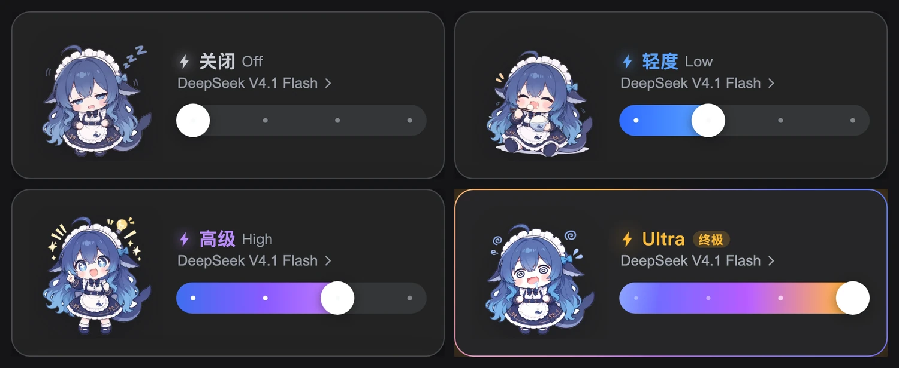

# dsh-effort-mascot

A reasoning-effort slider for **DeepSeek Harness** — it replaces the composer's effort control with a dark card: a per-tier gradient slider, and a mascot illustration that changes with the level.

把 DSH 聊天框右下角的「推理强度」控件换成一张深色滑杆卡片：滑杆按档位换色，四档各配一张角色插画。



## Install

Clone the repo somewhere permanent, then link it into your profile:

```sh
git clone https://github.com/<your-name>/dsh-effort-mascot.git
dsh plugin --profile web add ./dsh-effort-mascot
```

Restart `dsh web` afterwards (the Host half registers the illustration route at boot). The composer control is replaced on the next page load.

## Compatibility

| | |
|---|---|
| Tested with | DSH `0.2.1-rc.2` |
| Mechanism | shadows the shipped `conversation.input.model` slot at `priority: -1` |
| Failure mode | if that seat's contract changes, this plugin silently does not register — the official control stays, nothing breaks |
| Blast radius | none on the Host, the session log, or what the model sees: selection still goes through `session.selectModel` |

## Tiers

| Level | Colour | Illustration |
|---|---|---|
| Off | neutral grey | dozing |
| Low | blue | snacking |
| High | purple | idea |
| Max (shown as **Ultra**) | gold + badge | overloaded |

The top level adds colour-only motion (rotating conic ring, card brightness breathing, slider sheen, bolt glow), plus a one-off splash line when you land on it. Everything respects `prefers-reduced-motion`.

## Custom illustrations

Files live at `assets/<effort-id>.webp` — 360×360 transparent canvas, subject height normalised so the four characters read at the same size. The Host half serves them from `GET /model-effort/asset/<name>` (a Client bundle cannot import an image).

- Replace a file with the same name → reload the page (the asset cache invalidates on mtime + size).
- Add art for another level → drop the file and add one line to `TIER_IMAGES` in `client.js`.

The bundled art is AI-generated sample material, replace it with whatever you like.

## Remove

```sh
plugin_manager remove_bundle target=dsh-effort-mascot
```

The shipped control comes back immediately; nothing is left behind.

## Known limitations

- The trigger does not use the shipped `conversation.input.model.label` slot, so the `1017` badge contributed by `ui-deepseek-model-label-1017` is not shown on this button.
- The in-card model list has no search (fine for a couple of models; use `/model` for the full picker).
- The card is always dark and does not follow the light/dark theme.
- Diagnostics: render failures are written to `~/.dsh/model-effort.log`.

## License

Code: MIT. Illustrations: AI-generated samples, not claimed as original works.
