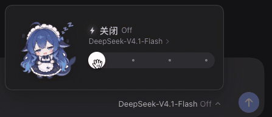

# dsh-effort-mascot

[English](README.en.md) | **中文**

把 **DeepSeek Harness** 聊天框右下角的「思考推理强度」调节，从一行下拉变成一个**会变脸的滑杆卡片**。功能还是原来那个功能 —— 选 off / low / high / max，只是把这件事做得有意思了一点。

**同一只大肥鱼，四档四种状态**：关闭时半睁着眼打瞌睡、轻度捧着碗扒饭、高级星星眼灵光一闪、Ultra 想到眼冒漩涡、口水直流。卡片配色跟着档位走 —— 灰白 → 蓝 → 紫 → 金色彩环，滑杆按档位填充渐变。落到 Ultra 还会先弹一句「思考强度最大时，可能消耗更多词元」，三秒后渐退（提醒这一档更费 token）。

> **一个需要说清楚的映射**：界面上的 **Ultra 就是 DeepSeek 的 `max` 档**。只是换了个更好记的名字和一套视觉，提交给模型的仍然是 `reasoningEffort: "max"`；其余三档沿用官方原名（Off / Low / High）。

底层没有任何改动：复用官方模型目录与 `session.selectModel`，只是同一个控件的另一种画法。

> **卡片固定深色，不跟随明暗主题。** 这是刻意的：它是一块浮在输入框上的「深色材质」，浅色页面里也保持同一个样子，好让插画和金色高光始终成立。


从低到高依次滑过，最后落到 Ultra（会先弹一次大字提示）：



## 安装

把仓库克隆到一个固定位置，再链接进你的 profile：

```sh
git clone https://github.com/LingHXiao/dsh-effort-mascot.git
dsh plugin --profile web add ./dsh-effort-mascot
```

装完**重启一次 `dsh web`**（宿主半侧在启动时挂载插画路由），然后刷新页面即可看到新控件。

## 四档：配色与表情

| 档位 | 配色 | 表情 | 在表达什么 |
|---|---|---|---|
| **关闭 Off** | 灰白，滑杆不填充 | 打瞌睡：眼睛半睁、嘴角挂着口水、头顶飘着 `Zzz` | 完全没在思考，安心摆烂 |
| **轻度 Low** | 亮蓝，填充到 1/3 | 扒饭：腮帮子鼓鼓、闭着眼吃得正香、手里捧着饭碗 | 一边吃一边随便想想，不费力 |
| **高级 High** | 紫色，填充到 2/3 | 灵光一闪：星星眼、食指竖起、头顶亮起灯泡、四周冒出小星星 | 想到点子了，开始认真动脑 |
| **Ultra**（= DeepSeek 的 `max` 档） | 金色 + `终极` 徽章，滑杆蓝→紫→金 | 想到宕机：漩涡眼、口水滴落、四周一圈晕眩线 | 全功率运转，脑子已经打结 |

**Ultra 档的额外表现**：

- 拖动落到该档后，整张卡先变成一行大字 ——「思考强度最大时，可能消耗更多词元」—— 3 秒后渐退，再回到正常卡片（提醒这一档会更费 token）
- 纯颜色类动效：彩环旋转、整卡亮度呼吸、滑杆流光、闪电辉光
- 全部遵循系统的「减少动态效果」设置；开启后大字提示会直接跳过

## 兼容性

| | |
|---|---|
| 实测版本 | DSH `0.2.1-rc.2` |
| 实现方式 | 在 `priority: -1` 上遮蔽官方 `conversation.input.model` 座位 |
| 失效表现 | 若 DSH 改了该座位的契约，插件会**静默不注册** —— 官方控件照常显示，不会把界面弄坏 |
| 影响范围 | 不碰 Host、不碰会话日志、不改变模型实际收到的内容；选择仍走 `session.selectModel` |

## 换插画

图片放在 `assets/<档位 id>.webp`：360×360 透明画布，角色本体高度已归一化，所以四张放在一起看起来一样大。宿主半侧通过 `GET /model-effort/asset/<文件名>` 提供（Client bundle 不能直接 import 图片）。

- **换图**：同名文件覆盖即可 → 刷新页面生效（缓存按文件 mtime + size 自动失效）
- **加一档的图**：放入文件，再在 `client.js` 的 `TIER_IMAGES` 里加一行

仓库内自带的插画是 AI 生成的示例素材，可以随意替换成你自己的图。

## 卸载

```sh
plugin_manager remove_bundle target=dsh-effort-mascot
```

官方控件立即恢复，不留残留。

## 已知限制

- 触发按钮不走官方的 `conversation.input.model.label` 槽位，所以 `ui-deepseek-model-label-1017` 提供的 `1017` 小徽标在该按钮上不显示。
- 卡片内的模型列表没有搜索（模型少时够用，要完整选择器请用 `/model`）。
- 诊断：渲染异常会写入 `~/.dsh/model-effort.log`。

## 许可

代码 MIT。插画为 AI 生成的示例素材，不主张著作权。
