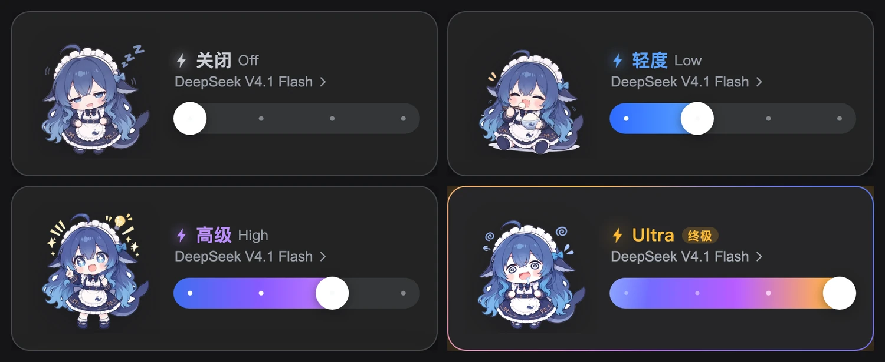

# dsh-effort-mascot · 中文说明

[English](README.md) | **中文**

把 **DeepSeek Harness** 聊天框右下角的「推理强度」控件，换成一张深色滑杆卡片：滑杆按档位换色，四档各配一张角色插画。



## 安装

把仓库克隆到一个固定位置，再链接进你的 profile：

```sh
git clone https://github.com/LingHXiao/dsh-effort-mascot.git
dsh plugin --profile web add ./dsh-effort-mascot
```

装完**重启一次 `dsh web`**（宿主半侧在启动时挂载插画路由），然后刷新页面即可看到新控件。

## 兼容性

| | |
|---|---|
| 实测版本 | DSH `0.2.1-rc.2` |
| 实现方式 | 在 `priority: -1` 上遮蔽官方 `conversation.input.model` 座位 |
| 失效表现 | 若 DSH 改了该座位的契约，插件会**静默不注册** —— 官方控件照常显示，不会把界面弄坏 |
| 影响范围 | 不碰 Host、不碰会话日志、不改变模型实际收到的内容；选择仍走 `session.selectModel` |

## 四档

| 档位 | 颜色 | 插画 |
|---|---|---|
| 关闭 Off | 灰白 | 打瞌睡 |
| 轻度 Low | 蓝 | 扒饭 |
| 高级 High | 紫 | 灵光一闪 |
| 最高 Max（显示为 **Ultra**） | 金色 + 徽章 | 想到宕机 |

最高档额外有**纯颜色类**动效：旋转彩环、整卡亮度呼吸、滑杆流光、闪电辉光，以及拖到该档时的一次性大字提示。全部遵循系统的「减少动态效果」设置。

## 换插画

图片放在 `assets/<档位 id>.webp`：360×360 透明画布，角色本体高度已归一化，所以四张放在一起看起来一样大。宿主半侧通过 `GET /model-effort/asset/<文件名>` 提供（Client bundle 不能直接 import 图片）。

- **换图**：同名文件覆盖即可 → 刷新页面生效（缓存按文件 mtime + size 自动失效）
- **加一档的图**：放入文件，再在 `client.js` 的 `TIER_IMAGES` 里加一行

仓库内自带的插画是 AI 生成的示例素材，可以随意替换成你自己的图。

## 卸载

```sh
plugin_manager remove_bundle target=dsh-effort-mascot
```

官方控件立即恢复，不留残留。

## 已知限制

- 触发按钮不走官方的 `conversation.input.model.label` 槽位，所以 `ui-deepseek-model-label-1017` 提供的 `1017` 小徽标在该按钮上不显示。
- 卡片内的模型列表没有搜索（模型少时够用，要完整选择器请用 `/model`）。
- 卡片固定深色，不跟随明暗主题。
- 诊断：渲染异常会写入 `~/.dsh/model-effort.log`。

## 许可

代码 MIT。插画为 AI 生成的示例素材，不主张著作权。
